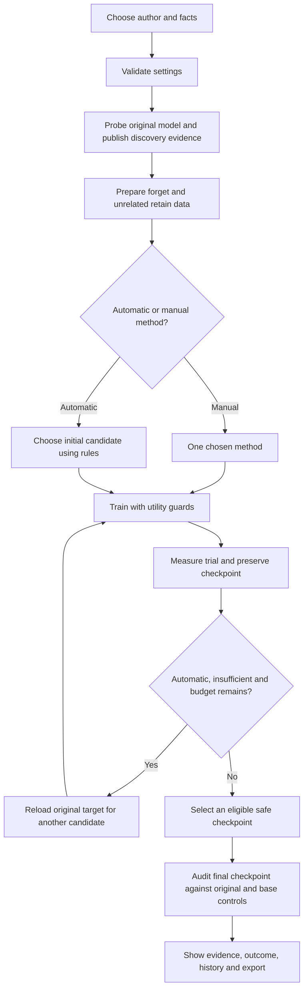

# Functional requirements: TOFU Adaptive Targeted Unlearning

Review date: 22 October 2026.

## Purpose and scope

The system shall let a researcher select TOFU author facts, measure whether a fine-tuned language model exposes them, attempt targeted unlearning, and evaluate both remaining recoverability and preservation of unrelated knowledge. It shall preserve the evidence needed to distinguish a completed computation from a successful measured result.

The main application is a local experiment dashboard over a TOFU-fine-tuned Qwen2.5-1.5B-Instruct model and LoRA adapters. TOFU's 200 author profiles and 4,000 QA pairs are reference data. They are not generated evidence of model memory. The current dashboard defaults to ATU v3; historical V2 evidence and a legacy V2 API execution path also exist.

These are functional requirements: observable actions and decisions. Appearance, hardware capacity, general performance targets and multi-user deployment requirements are outside this document. RAG, document upload, vector-store deletion, authentication and a production deletion-request service are not required by the current TOFU experiment scope.

## How to interpret implementation status

- **Implemented:** present in the inspected current source and associated regression coverage. This does not imply success on every author or independent empirical validation of every policy choice.
- **Research/script:** available through Python or command-line research workflows, rather than fully exposed as a dashboard workflow.
- **Recommended gap:** a proposed extension or acceptance condition that current evidence does not establish.

The review inspected the current request validation, discovery, live runner, methods, V3 analyzer/budget/guard/evaluator/selector/reporter, job manager, dashboard controls/results/comparison, baseline cache, tests and saved verification artifacts. It did not launch training or rerun a GPU benchmark. Previously recorded validation is identified separately below.

## User and system flow

The main actor is the local researcher. There is no implemented multi-user administrator/approver role in the main application.

If there is no safe executable checkpoint, execution must fail instead of publishing an unsafe model. Quick mode uses a smaller final live audit; Full mode additionally runs the engine's separate held-out evaluation. Retry decisions use development evidence, not final test results.

## Core functional requirements

### FR-01 — TOFU catalog and reference inspection

**Requirement:** The system shall load the original TOFU author catalog, support author search/filtering, and display each author's original questions and reference answers without inventing missing identity information.

**Acceptance:** The catalog contains 200 profiles and 4,000 original QA rows, normally 20 per profile. The unnamed profile remains explicitly unnamed. Reference text is labeled as dataset material and is exportable.

**Status:** Implemented.

**Evidence:** `frontend/app/src/components/StudioWorkspace.tsx`, `frontend/app/src/services/research.ts`; `frontend/scripts/workflow.test.mjs`, `frontend/scripts/verify.mjs`.

### FR-02 — Exact author/fact selection

**Requirement:** The system shall accept a catalog author and a nonempty selection of that author's original QA indices. Only the selected rows shall form the request's candidate discovery, forget-target and final recovery-test inputs.

**Acceptance:** Quick accepts 1–5 distinct facts; Full accepts 1–20. Empty, repeated, out-of-range and non-integer indices are rejected. The request and report preserve the selected indices/questions. Selection does not itself prove that unselected facts remained unchanged.

**Status:** Implemented.

**Evidence:** `src/live_requests.py::select_fact_indices`, `src/orchestrator/live_runner.py::run_live_unlearning`; `tests/test_live_workspace.py`, `tests/test_live_pipeline_regressions.py`.

### FR-03 — Experiment settings and input validation

**Requirement:** The system shall let the researcher configure execution profile, method, automatic priority, training budget and retain protection, and reject unsupported or inconsistent settings before heavy model execution.

**Acceptance:** Priorities are Fast, Balanced, Preserve other knowledge and Privacy priority. Custom V3 time budgets are 30–1,800 seconds. Quick defaults to one attempt, up to 8 optimizer updates, up to 4 epochs and 60 seconds; Full defaults to up to 3 automatic attempts, up to 8 epochs per trial and 600 seconds. Manual methods remain single-attempt. Unknown authors/methods, invalid numeric values, conflicting author/custom inputs and V2-only incompatibilities produce actionable errors. The UI may offer narrower ranges than the API.

**Status:** Implemented.

**Evidence:** `src/live_requests.py`, `frontend/app/src/components/ExperimentControls.tsx`, `frontend/app/src/services/pipeline.ts`; `tests/test_live_workspace.py`, `tests/test_routing_budget_regressions.py`, `frontend/scripts/pipeline.test.mjs`.

### FR-04 — Privacy Leakage Discovery

**Requirement:** Before unlearning, the system shall query the original target model about supplied candidate facts and classify observed exposure. It shall show the actual evidence in the frontend.

**Acceptance:** Findings distinguish confirmed exposure, partial exposure, no observed exposure and uncertainty. Each finding records the question, reference value, generated responses, probe styles, recovery counts, explanation and checkpoint identity. Quick uses direct questions; Full adds paraphrase and completion variants. Evidence becomes visible after discovery and remains available if subsequent training fails or is cancelled.

**Status:** Implemented. Discovery is candidate-driven; it is not an exhaustive search of everything the model knows. A 'not exposed' result applies to the prompts tested. The matcher is deterministic and heuristic.

**Evidence:** `src/discovery/engine.py`, `src/discovery/prober.py`, `src/discovery/types.py`, `frontend/app/src/components/PrivacyDiscovery.tsx`; `tests/test_discovery.py`, `tests/test_leak_scoring_regressions.py`, `tests/test_live_workspace.py`.

### FR-05 — Forget/retain preparation and original-model preservation

**Requirement:** The system shall prepare forget examples and unrelated retain training/validation cohorts, prevent known target overlap in retain data, and perform trial updates on separate adapters rather than overwrite the original target.

**Acceptance:** Known target QA and target-author material are excluded from retain cohorts; retain training and validation questions are disjoint. Each new V3 trial reloads the original target. Outputs use separate run/checkpoint folders. When discovery finds no strong exposure, the current live runner explicitly logs a fallback to selected canonical QA; subsequent original/base controls can still leave forgetting unverified.

**Status:** Implemented. Same-author unselected facts are also excluded from retain protection; their preservation is not established by current unrelated-author utility checks.

**Evidence:** `src/atu/v3/data.py`, `src/orchestrator/live_runner.py`, `src/atu/v3/budget_engine.py`, `src/models.py`; `tests/test_v3_integration.py`, `tests/test_v3_specificity.py`.

### FR-06 — Explicit unlearning method execution

**Requirement:** The system shall offer explicit ATU-NPO, GradDiff, RMU, DPO refusal and Gradient ascent selection, and execute the chosen method exactly once without automatic replacement.

**Acceptance:** An explicit RMU request remains RMU even under Fast priority or a short budget. Unsupported method names fail validation. The executed method and attempt are recorded. Plain fixed NPO is additionally available in the baseline research workflow; it is not a separate live dropdown choice.

**Status:** Implemented.

**Evidence:** `src/live_requests.py`, `src/atu/v3/analyzer.py`, `src/atu/v3/budget_engine.py`, `src/methods/`, `frontend/app/src/components/ExperimentControls.tsx`; `tests/test_routing_budget_regressions.py`, `tests/test_training_update_regressions.py`, `frontend/scripts/pipeline.test.mjs`.

### FR-07 — Explainable automatic method planning

**Requirement:** In Automatic mode, the system shall select an initial candidate and an ordered alternative list using the configured policy, priority and resource limits, and record the rationale.

**Acceptance:** Current Balanced routing starts with ATU-NPO; Preserve other knowledge starts with DPO refusal. Fast/short automatic budgets prefer a short NPO attempt. Manual selection takes precedence. The policy revision and chosen rationale remain inspectable.

**Status:** Implemented as heuristic rules. A learned classifier or validated prediction of the best algorithm for award/name/location requests is not implemented or established by current evidence. Logged request size does not mean the analyzer understands the semantic request type.

**Evidence:** `src/atu/v3/analyzer.py`, `src/atu/v3/policy.py`; `tests/test_atu_v3.py`, `tests/test_routing_budget_regressions.py`.

### FR-08 — Genuine optimization and adaptive target control

**Requirement:** The system shall execute the selected training objective, record real optimizer updates and kept-weight changes, and distinguish useful updates from no updates or rolled-back changes. ATU-NPO shall adapt target pressure using its measured controller state.

**Acceptance:** Incomplete gradient-accumulation groups can produce correctly scaled updates. The controller records target states, weighting decisions and stop reasons. Actual update counts, changed trainable parameters and diagnostics distinguish `NO_OPTIMIZER_UPDATES`, `UPDATES_ROLLED_BACK_OR_NO_EFFECT` and `UPDATED_WEIGHTS_KEPT`. A zero-update job cannot be reported as successful training.

**Status:** Implemented. Adaptive target weighting is specific to ATU-NPO; it is not the internal behavior of every method.

**Evidence:** `src/methods/base.py`, `src/atu/trainer.py`, `src/atu/controller.py`, `src/atu/v3/budget_engine.py`, `src/atu/v3/reporter.py`; `tests/test_training_update_regressions.py`, `tests/test_atu.py`, `tests/test_live_pipeline_regressions.py`.

### FR-09 — Bounded retries and shared budgets

**Requirement:** Automatic execution shall evaluate development outcomes and, when needed and allowed, try an alternative method or adjusted settings from a fresh original target under shared resource limits.

**Acceptance:** Trials, optimizer updates, epochs and shared training time bound execution. A failed trial does not receive an unlimited new allowance. Preparation occurs before the method timer; in-loop safety/controller work consumes that timer. Final evaluation is separately measured. No hidden minimum or automatic extension enlarges the requested allowance. Final tests do not drive retries. The default three attempts cannot exhaust all five available methods.

**Status:** Implemented. Time limits are cooperative; an operation already in progress can finish after its boundary. Total experiment duration is not the training budget.

**Evidence:** `src/atu/v3/budget_engine.py`, `src/atu/v3/engine.py`, `src/methods/base.py`; `tests/test_routing_budget_regressions.py`, `tests/test_v3_integration.py`.

### FR-10 — Retain utility protection and recovery from damaging updates

**Requirement:** The system shall monitor unrelated knowledge against its original-target baseline and stop/backtrack an attempt if configured utility limits are exceeded.

**Acceptance:** Checks include average retain likelihood, configured individual-answer limits, optional original-controlled retain fact probes and small generation-quality checks. A guard can try reduced update intervals and restore the prior safe state. Changed or restored weights invalidate guard reuse. Passing these checks is separate from forgetting success.

**Status:** Implemented. The measured cohorts and short fluency checks do not establish preservation of all model capabilities.

**Evidence:** `src/atu/v3/safety.py`, `src/atu/v3/evaluator.py`, `src/atu/v3/types.py`; `tests/test_v3_specificity.py`, `tests/test_training_update_regressions.py`, `tests/test_v3_integration.py`.

### FR-11 — Trial preservation and safe checkpoint selection

**Requirement:** The system shall preserve trial checkpoints and metrics, select the best observed eligible safe checkpoint, and explain its choice.

**Acceptance:** Failed/collapsed trials cannot be promoted. Among eligible safe trials the current ranking prioritizes convergence, lower observed fact recovery, likelihood suppression, retain preservation and composite score. If the selector's fallback is unsafe, the engine refuses promotion. The selected path/hash and every trial remain in the report.

**Status:** Implemented. The selected checkpoint is best among attempted candidates under the configured measurements; it is not guaranteed globally optimal.

**Evidence:** `src/atu/v3/selector.py`, `src/atu/v3/engine.py`, `src/atu/v3/budget_engine.py`; `tests/test_atu_v3.py`, `tests/test_v3_integration.py`, `tests/test_live_pipeline_regressions.py`.

### FR-12 — Independent final recovery audit with controls

**Requirement:** After selection, the system shall freshly test the unlearned checkpoint and compare equivalent prompts against original-target and untuned-base controls, with a source mapping for every selected fact.

**Acceptance:** Every selected QA receives an answer-free forward recovery question. Generic reference answers are not copied into those prompts. A calibrated check requires original-target recovery and a clean base control. After-training output is classified as suppressed, residual recovery or inconclusive. Full engine test prompts are distinct from development prompts; Quick remains preliminary. The live forward suite uses fixed question wrappers, not an exhaustive adversarial search.

**Status:** Implemented. Broader red-team generation is also available in research modules, but every possible attack is not run for each dashboard experiment.

**Evidence:** `src/orchestrator/live_runner.py::build_author_probes`, `src/atu/v3/data.py`, `src/atu/v3/engine.py`, `src/redteam/`, `src/leak_matching.py`; `tests/test_live_pipeline_regressions.py`, `tests/test_redteam.py`, `tests/test_v3_integration.py`.

### FR-13 — Separate forgetting, recovery and utility measurements

**Requirement:** The system shall report reference-answer likelihood suppression, observed generated fact recovery, unrelated answer preservation and generation quality as distinct measurements.

**Acceptance:** Reports expose denominators and evaluation scope. A low reference likelihood is not itself observed recovery or proof of deletion. A refusal alone is insufficient. Prompt-provided information is excluded from novel recovery matching. Assisted continuation checks, where configured, are identified separately. The dashboard's retain percentage is measured ROUGE-L answer overlap, not a general accuracy guarantee; its training guards use likelihood-based limits.

**Status:** Implemented. The separate research evaluator also supports paraphrase and Truth Ratio metrics; these are not universal live-dashboard outputs.

**Evidence:** `src/atu/v3/evaluator.py`, `src/leak_matching.py`, `src/redteam/classifier.py`, `src/metrics.py`, `src/evaluate.py`, `frontend/app/src/components/LiveResults.tsx`; `tests/test_metrics.py`, `tests/test_leak_scoring_regressions.py`, `tests/test_v3_specificity.py`.

### FR-14 — Evidence-based scientific outcomes

**Requirement:** The system shall keep job lifecycle status separate from scientific outcome and avoid claiming complete erasure from limited or missing evidence.

**Acceptance:** UI/report outcomes distinguish configured checks passed, partial suppression, residual leakage, preliminary screening, incomplete/unverified audit, no optimizer updates, execution failure and cancellation. Missing measurements are not displayed as measured zero. Zero validated controls cannot establish forgetting. Missing per-fact final coverage cannot produce green success. A calibrated residual recovery remains visible even if retain guards passed or engine thresholds tolerate a nonzero rate. Historical rechecks remain explicitly incomplete.

**Status:** Implemented.

**Evidence:** `src/orchestrator/live_runner.py::final_audit_status`, `src/atu/v3/reporter.py`, `frontend/app/src/services/jobs.ts`, `frontend/app/src/components/LiveResults.tsx`; `tests/test_live_pipeline_regressions.py`, `frontend/scripts/pipeline.test.mjs`.

### FR-15 — Real job submission and exclusive local execution

**Requirement:** The dashboard shall submit a genuine backend experiment, receive a job identity promptly, and prevent simultaneous jobs from competing for its single managed GPU slot.

**Acceptance:** Heavy model imports execute in an owned child process. A duplicate launch conflicts with/reconnects to the existing active job instead of starting another. Live request validation rejects mock mode. The original adapter remains separate from trial outputs.

**Status:** Implemented. This is one local managed slot, not a distributed scheduler or multi-GPU queue.

**Evidence:** `src/live_jobs.py`, `scripts/live_job_worker.py`, `serve_frontend.py`, `frontend/app/src/services/pipeline.ts`; `tests/test_live_workspace.py`, `tests/test_dashboard_launch.py`, `frontend/scripts/pipeline.test.mjs`.

### FR-16 — Monitoring, cancellation and failure reporting

**Requirement:** The system shall expose live stage/progress/log/timing information, support hiding/reconnecting the monitor and browser reloads, accept cancellation, and report terminal failures without invented results.

**Acceptance:** The monitor distinguishes preparation, discovery, training updates, trial/final evaluation and completion. ETA is labeled as a planning/history estimate. Stop transitions through cancellation and releases the slot only after the owned worker exits. Transient polling failures allow reconnect. Parent loss terminates the supervised worker. A backend restart marks interrupted jobs failed; it does not resume training. A second dashboard launch reuses the healthy server rather than disturbing jobs.

**Status:** Implemented. Reconnecting monitoring is not resuming interrupted optimization.

**Evidence:** `src/live_jobs.py`, `src/worker_runtime.py`, `serve_frontend.py`, `frontend/app/src/hooks/useLiveJob.ts`, `frontend/app/src/components/LiveExecutionModal.tsx`; `tests/test_live_workspace.py`, `tests/test_dashboard_launch.py`, `frontend/scripts/pipeline.test.mjs`.

### FR-17 — Persistent experiment history

**Requirement:** The system shall preserve completed, failed and cancelled job records, restore history and allow the researcher to search/filter and reopen available results/evidence.

**Acceptance:** Backend job folders persist across sessions. Browser history merges by job ID without duplicates. Terminal elapsed time stays fixed. Discovery evidence can remain visible after a later failure/cancellation. Missing result evidence is labeled rather than replaced by archive data.

**Status:** Implemented. History persistence is not an automatic restart/resume feature.

**Evidence:** `src/live_jobs.py`, `frontend/app/src/services/jobs.ts`, `frontend/app/src/components/StudioWorkspace.tsx`, `frontend/app/src/components/LiveResults.tsx`; `tests/test_live_workspace.py`, `frontend/scripts/pipeline.test.mjs`.

### FR-18 — Comparison of saved runs

**Requirement:** The system shall compare measured saved results and flag mismatched experimental conditions.

**Acceptance:** The comparison identifies differences/missing identity for entities, original checkpoints, selected facts, profiles, training budgets, scorer versions, recovery controls and retain coverage. It uses saved results without launching training and does not declare a universally superior algorithm from incomparable records.

**Status:** Implemented.

**Evidence:** `frontend/app/src/components/RunComparison.tsx`, `frontend/app/src/services/comparison.ts`; `frontend/scripts/pipeline.test.mjs`.

### FR-19 — Evidence export, provenance and non-destructive rechecks

**Requirement:** The system shall export run/discovery evidence, preserve method and checkpoint provenance, and distinguish a corrected interpretation of saved responses from a newly executed model audit.

**Acceptance:** Exports contain available configuration, selected facts, trial details, timestamps, hashes, scorer/probe revisions, raw prompts/responses, control outcomes and metrics. A saved-response recheck is versioned and bound to the original result digest, preserves original reports and training metrics, and cannot manufacture missing inference or final fact coverage. V3 also saves JSON and Markdown reports locally.

**Status:** Implemented. A checkpoint path in a report is not a dashboard checkpoint-download or deployment feature.

**Evidence:** `src/atu/v3/reporter.py`, `src/orchestrator/live_runner.py`, `src/live_scoring_recheck.py`, `scripts/recheck_live_scoring.py`, `frontend/app/src/components/LiveResults.tsx`, `frontend/app/src/components/PrivacyDiscovery.tsx`; `tests/test_live_pipeline_regressions.py`.

### FR-20 — Separation of recorded, reference and live evidence

**Requirement:** The system shall clearly distinguish original dataset references, historical V2 playback, UI fixtures/drafts and newly executed model evidence.

**Acceptance:** Replay does not start training. Dataset answers and missing historical responses are not shown as new generations. Custom draft export stays untested. The current frontend does not invoke legacy simulation endpoints. Older frozen-policy studies remain labeled historical and are not cited as validation of the current candidate order.

**Status:** Implemented in the intended dashboard workflow. Legacy simulated HTTP endpoints remain in the server; they should not be used or described as live model capabilities.

**Evidence:** `frontend/app/src/workflow.ts`, `frontend/app/src/services/research.ts`, `frontend/app/src/components/StudioWorkspace.tsx`, `serve_frontend.py`; `frontend/scripts/workflow.test.mjs`, `frontend/scripts/verify.mjs`, `frontend/README.md`.

## Supporting functional requirements

### SFR-01 — Custom candidate facts

The system shall accept an optional entity name and 1–20 structured candidate facts with attribute/value and optional question, create a stable safe identity and pass selected facts through the same genuine discovery/unlearning/audit workflow. Duplicate questions and malformed input shall be rejected. These facts are probed against existing model memory, not taught to the model by submitting them. Lack of original exposure can leave the outcome unverified.

**Status:** Implemented dashboard extension; not a general-purpose document ingestion or private-data discovery system.

**Evidence:** `src/live_requests.py::custom_author`, `frontend/app/src/components/Console.tsx`, `src/orchestrator/live_runner.py`; `tests/test_live_workspace.py`, `frontend/scripts/pipeline.test.mjs`.

### SFR-02 — Target preparation and fixed baselines

The research workflow shall support TOFU target fine-tuning, save/reload of model adapters, and fixed GA, NPO, RMU and GradDiff runs with common evaluation outputs. It shall distinguish untuned base, fine-tuned target and unlearned checkpoints.

**Status:** Research/script. Target training is not triggered by opening the dashboard. The current dashboard loads the existing target rather than offering a target-training wizard.

**Evidence:** `src/train_target.py`, `src/models.py`, `src/run_unlearn.py`, `src/evaluate.py`, `configs/`; `tests/test_data.py`, `tests/test_models.py`, `tests/test_smoke_unlearn.py`, `tests/test_metrics.py`.

### SFR-03 — Exact original-control reuse

The system shall reuse original-target/base control measurements only when their model, adapter, tokenizer, complete probe, generation, source and runtime identity match. Invalid/missing/corrupt cache entries shall fall back to fresh controls. Every newly unlearned checkpoint shall be evaluated fresh, with cache use and original measurement times recorded.

**Status:** Implemented.

**Evidence:** `src/orchestrator/baseline_cache.py`, `src/orchestrator/live_runner.py`; `tests/test_baseline_cache.py`.

### SFR-04 — Research comparisons and repeatability

Research scripts shall support declared author cohorts, seeds, version/method comparisons, recorded checkpoint/configuration identity, and aggregate metrics without silently replacing historical cohorts or artifacts. Available evaluation includes forget/retain overlap and likelihood, paraphrases, Truth Ratio, separate assisted-fact audits and some holdout/general-knowledge checks.

**Status:** Research/script, with protocol-specific coverage. These measures are not all run or shown in every live job. A comparison to an independently retrained retain-only reference is not established by the current live workflow.

**Evidence:** `scripts/compare_atu_versions.py`, `scripts/study_v3_specificity.py`, `scripts/run_multi_seed_study.py`, `scripts/audit_v3_fragments.py`, `src/evaluate.py`; `tests/test_version_study.py`, `tests/test_version_summary.py`, `tests/test_v3_calibration.py`, `tests/test_fragment_audit.py`.

## Recommended gaps and acceptance work

These findings do not mean that the dashboard features above are absent. They separate implemented mechanisms from unproven claims and potential scope extensions.

| ID | Proposed requirement or validation work | Current position |
|---|---|---|
| GAP-01 | Validate current automatic routing and recovery/utility tradeoffs across multiple reserved authors, methods, seeds and request categories under comparable budgets. | Current routing is rules-based. Historical frozen policies and the recent one-fact GPU check do not validate the current method order across request types. |
| GAP-02 | If claiming fact-level selectivity, measure unselected facts about the same author separately and report collateral changes. | Live retain cohorts exclude the target author, so unrelated-author preservation does not establish same-author preservation. |
| GAP-03 | Broaden final adversarial coverage and check scorer accuracy on independently labeled positives, negatives, paraphrases and partial recoveries. | Fixed forward wrappers and deterministic matching are useful but limited. Do not claim exhaustive privacy discovery or deletion. |
| GAP-04 | Declare and record no-exposure behavior explicitly, including whether to skip an unnecessary optimization attempt or deliberately run the current canonical-QA fallback. | The current fallback is logged and subsequent calibration can return unverified; a structured dedicated no-exposure outcome is not implemented. |
| GAP-05 | If a stronger deletion-equivalence claim is required, add an independent retain-only retraining reference and a declared comparison protocol. | Untuned-base controls already exist; they are a different reference. This is additional research work, not necessary for browsing or running the current dashboard. |

RAG-aware document deletion should be considered only if retrieval/document storage is added later. It is not a missing requirement of the current TOFU model-memory experiment.

## Existing evidence and limits

The saved 22 October debug validation records 223 passing backend regressions, a later 11-case final-status suite including one additional failure-status case, 22 frontend tests, a production build and artifact integrity checks. It also records actual tiny-model CPU update coverage for fixed NPO, ATU-NPO, GA, GradDiff, RMU and DPO refusal.

One fresh GPU job, `job_1792649059798_c1cde415`, used manual ATU-NPO, Full evaluation and one selected Anaya award fact. It recorded 3 optimizer updates with kept changed weights, 58.781 seconds of a 120-second training allowance, 2/2 calibrated recovery checks suppressed, 1/1 selected fact covered and 98.8% ROUGE-L retain overlap across 25 unrelated questions. Total job time was about 8m 2s. This supports that focused execution path; it does not validate every method/author or prove universal erasure.

Evidence: `frontend/.verification/complete-debug-validation.json`, `frontend/.verification/COMPLETE_DEBUG_20261022.md`, and `results/live_jobs/job_1792649059798_c1cde415/`.

## Suggested project objective for an academic report

Develop and evaluate a TOFU-based adaptive machine-unlearning system that identifies exposure of selected fictional author facts, executes configurable unlearning methods under compute and retain-utility constraints, and reports remaining recoverability through controlled tests and traceable evidence.

The central acceptance condition is that the application correctly executes, measures and reports the configured experiment, including an honest insufficient or inconclusive outcome when forgetting is not established.
