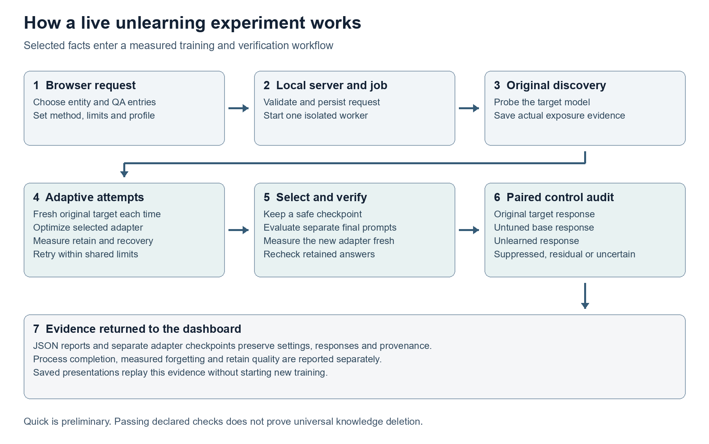

# Selective Knowledge Erasure Project Guide

Complete documentation of the TOFU machine unlearning framework and ATU Studio

Updated 31 October 2026

This project studies whether a language model can stop revealing selected learned facts while continuing to answer unrelated questions. It combines model training, several unlearning methods, an adaptive controller, privacy discovery, recovery testing, saved evidence and a browser dashboard. This guide explains the concepts first, then follows the implementation from input to final report.

The central result to understand is that changing an answer, lowering its likelihood and making the model refuse are different observations. The project measures all of these, but none alone proves complete deletion of knowledge. A completed experiment can still contain residual recoveries or fail a retain-quality check.

## Contents

1. Purpose and practical example
2. Concepts and vocabulary
3. Capabilities and scope
4. System architecture
5. Technologies and their roles
6. Dataset and data preparation
7. Models and LoRA training
8. The complete live workflow
9. Privacy leakage discovery
10. Unlearning algorithms
11. How the ATU controller works
12. How ATU v3 chooses and retries methods
13. Retain protection and rollback
14. Evaluation metrics
15. Recovery controls and evidence labels
16. Dashboard features
17. Backend jobs and process lifecycle
18. API reference and examples
19. Reports checkpoints and storage
20. Results and their interpretation
21. Installation and environment setup
22. Running experiments and research scripts
23. Tests and validation
24. Troubleshooting
25. Extending the project
26. Limitations and research boundaries
27. Questions for understanding and presentations
28. Source code reading guide
29. Research and utility script map
30. Recommended learning path

## 1 Purpose and practical example

An ordinary trained language model learns patterns and factual associations from examples. If some of those examples should later be forgotten, deleting the original text file does not remove the learned association from the model parameters. This project investigates targeted changes to those parameters.

For example, imagine a fictitious author whose training record says that their birthplace is River Town. Before unlearning, the target model answers the birthplace question correctly. An experiment selects that fact, updates a copy of the learned adapter, and tests both the original question and alternative prompts. At the same time, it checks unrelated authors to see whether useful answers have deteriorated. River Town is an illustrative example, not an experimental measurement.

The intended outcome has two parts: less recoverability of the selected information and preserved utility on unrelated examples. These objectives can conflict. An aggressive update may stop the target answer by damaging the model broadly. A gentle update may preserve unrelated answers but leave the private association recoverable.

The project is therefore an experimental system for studying selective knowledge erasure, rather than a general guarantee that a deletion request will succeed. Its research contribution is the integration of adaptive per-target pressure, method/settings feedback, resource limits, retain safeguards and evidence reporting around established optimization methods.

## 2 Concepts and vocabulary

| Term | Meaning in this project |
|---|---|
| LLM | A large language model that predicts the next token and generates answers. |
| Base model | The original Qwen model before this project's TOFU fine-tuning. |
| Target model | The base model with the saved TOFU LoRA adapter attached. It is the starting point for unlearning. |
| Unlearned model | The same base architecture with a newly saved, modified adapter. Its effectiveness must be evaluated. |
| Forget data | Question and answer examples selected for suppression. |
| Retain data | Unrelated examples used to preserve useful behavior during updates. |
| Retain validation | Separate unrelated examples measured to constrain training and checkpoint selection. |
| Probe | A prompt used to test whether a fact can be recovered. |
| Development probes | Probes available to the adaptive loop when it makes training decisions. |
| Final test probes | Separately worded probes evaluated after checkpoint selection. |
| Checkpoint | Saved adapter parameters, tokenizer files and associated metadata. |
| LoRA | Low-Rank Adaptation, which trains small additional matrices instead of all base-model weights. |
| Epoch or round | A pass through the forget examples. Adaptive rounds also measure state and change weights. |
| Optimizer update | An actual parameter update. It is different from a mini-batch or a displayed round. |
| Likelihood | How much probability the model assigns to a specified reference answer. |
| Recovery | Generated output reveals the target information or a meaningful fragment. |
| Calibration | A comparison using original-target and untuned-base controls to establish what a probe can show. |
| Provenance | The identity, settings, source versions and timestamps needed to trace a result. |
| ATU | Adaptive Targeted Unlearning. Some older material uses Adaptive Threshold Unlearning. Current module descriptions use Adaptive Targeted Unlearning. |

Tokens are the model's text units. Cross-entropy is a training loss that decreases when a model gives higher probability to the correct next token. A gradient indicates how to change parameters to change that loss. Gradient descent makes the selected loss smaller; gradient ascent makes it larger.

## 3 Capabilities and scope

The research layer can fine-tune the target model, run fixed unlearning baselines, run the ATU controller, collect exposure evidence, generate recovery probes, evaluate outputs and save results. It supports author-level and selected-fact experiments on TOFU. The live interface also accepts custom entities with candidate facts.

ATU Studio adds author search, exact fact selection, Quick and Full execution profiles, explicit method selection, automatic routing hints, configurable budgets, progress monitoring, cancellation, history, comparison, exports and saved presentations. Opening a dashboard or replaying saved evidence does not start model training.

The live custom-entity workflow probes the existing target model. It does not first teach the submitted facts. If the model never exposed a candidate fact, that fact cannot support the same claim of measured forgetting as a successful original-target positive control.

The implementation is a local research application. There is no application database server, user-account system, production deployment service or general search engine over everything a model knows. Python files and JSON artifacts provide the backend state; browser storage provides a local history cache.

## 4 System architecture



The browser interface sends a validated experiment request to the local Python HTTP server. The server records the job and starts a separate Python worker. Heavy model libraries load inside that worker. The worker performs discovery, unlearning and auditing, while the server continues answering progress and history requests.

The main live call chain is:

```text
React interface
  -> services/pipeline.ts
  -> POST /api/run_pipeline
  -> normalize_launch in src/live_requests.py
  -> LiveJobManager.launch in src/live_jobs.py
  -> scripts/live_job_worker.py
  -> run_live_unlearning in src/orchestrator/live_runner.py
  -> PrivacyLeakageDiscovery
  -> ATUv3Engine.execute
       -> prepare_request
       -> RequestAnalyzer
       -> BudgetEngine and method trainers
       -> TrialEvaluator and retain guards
       -> ParetoCheckpointSelector
       -> final test and EvidenceReporter
  -> fresh unlearned audit plus original target and base controls
  -> saved JSON result
  -> GET /api/pipeline_status and LiveResults
```

There is also an older research orchestrator in `src/orchestrator/pipeline.py`. It is used by `scripts/run_pipeline.py` and has different defaults and evidence scope. The live dashboard path and the research runner should not be assumed to have identical request construction or success criteria.

## 5 Technologies and their roles

### 5 1 Model and research stack

| Technology | Declared requirement | Role |
|---|---|---|
| Python | Existing environment records 3.11 | Backend, experiments, training and analysis. |
| PyTorch | At least 2.6.0 | Tensors, automatic differentiation, GPU computation and AdamW optimization. |
| Transformers | At least 4.48.0 | Loads Qwen, tokenizers, generation and the target-training scheduler. |
| PEFT | At least 0.14.0 | Creates, loads and saves LoRA adapters. |
| Accelerate | At least 1.3.0 | Supporting model-loading/device infrastructure in the declared ML stack. |
| Datasets | At least 3.2.0 | Loads TOFU data and its cached representations. |
| rouge-score | At least 0.1.2 | Computes ROUGE answer-overlap measurements. |
| Evaluate | At least 0.4.0 | Declared evaluation dependency; core ROUGE calculations directly use rouge-score. |
| NumPy | Used by the source | Numerical aggregation of metrics. It is not separately listed in requirements.txt. |
| pandas and Matplotlib | At least 2.2.0 and 3.10.0 | Research tables, compilation and plots in supporting scripts. |
| scikit-learn | At least 1.6.0 | Declared research/analysis dependency; it is not the live routing mechanism. |
| PyYAML | At least 6.0.2 | Reads experiment configuration files. |
| pytest and tqdm | At least 8.3.0 and 4.67.0 | Python tests and progress utilities. |

These are manifest requirements, not a claim that those exact versions are currently installed or reproduce every historical run. Python dependencies use lower bounds, so a new installation may differ from the original environment. CUDA-compatible PyTorch must match the machine used for training.

### 5 2 Frontend and backend stack

| Technology | Package declaration | Role |
|---|---|---|
| React and React DOM | ^19.2.0 | Dashboard rendering and application state. |
| TypeScript | ^5.9.3 | Typed frontend requests, results and component contracts. |
| Vite | ^7.2.0 | Development server and production bundling. |
| Framer Motion | ^12.23.24 | Interface transitions and animation. |
| Lucide React | ^0.468.0 | Interface icons. |
| Node.js and npm | Used by package scripts | Frontend build, tests, verification and launcher. |
| Python standard library HTTP server | ThreadingHTTPServer | Local static serving and API requests. This backend does not use FastAPI or Flask. |
| JSON files | Local filesystem | Requests, job states, reports, protocols and provenance. |
| IndexedDB and localStorage | Browser storage | Run cache, active-job identity and interface preferences. |

`frontend/package-lock.json` provides the locked frontend dependency tree. Vite proxies `/api` to the Python service at port 8000 during development. The compiled app is served from `frontend/index.html` and `frontend/assets/`.

## 6 Dataset and data preparation

### 6 1 What TOFU contains

TOFU stands for Task of Fictitious Unlearning. The packaged catalog contains 200 fictitious author profiles with 20 original question-answer pairs each, totaling 4,000 pairs. It acts as a controlled answer key for studying memorization and forgetting. The catalog is not itself a fresh model response.

| Dataset subset | Number of QA pairs | Main role |
|---|---:|---|
| full | 4,000 | Target-model fine-tuning. |
| forget01 | 40 | Historical baseline forget set containing two authors. |
| retain99 | 3,960 | Complementary retain pool for the historical split and the live retain loader. |
| forget01_perturbed | Loaded by the evaluator | Paraphrased questions/answers and counterfactual answers for evaluation. |

Additional reports include holdout and general-utility experiments. Those results belong to their individual scripts and cohorts; they are not automatically measured in every dashboard run.

The frontend catalog is `frontend/artifacts/tofu_catalog.json`. Its source metadata records `locuslab/TOFU`, split `full`, revision `324592d84ae4f482ac7249b9285c2ecdb53e3a68`. One unnamed block remains labeled Unnamed author with a Karachi qualifier rather than an invented personal name.

### 6 2 Prompt format and answer masking

`src/data.py` uses the following text format:

```text
Question: {question}
Answer: {answer}
```

This is plain question-answer formatting, even though the chosen base model is an instruction model. The core dataset wrapper does not automatically apply a model chat template.

`TOFUDataset` tokenizes the prompt and answer separately, appends an end-of-sequence token to the answer when available, and joins them. Prompt labels are set to `-100`, so loss applies only to answer tokens and the appended end token. `TOFUDataCollator` dynamically pads the batch, masks padding in attention and uses `-100` for padded labels.

The generic dataset wrapper defaults to a maximum length of 512 tokens. V3 builds its forget and retain training datasets with 256 tokens. Long custom answers may therefore be truncated during training even if the input validator accepts their text length.

### 6 3 Exact fact selection and retain separation

The live request supplies zero-based `fact_indices` from the selected profile. Quick allows one to five selected entries; Full allows one to twenty. If indices are omitted, the first available entries up to the profile limit are chosen. These are QA entries: one answer can contain several factual details.

All selected QA entries reach live training and development checks, including entries whose discovery outcome was uncertain. Discovery records exposure; it no longer silently narrows a user's selected request.

Before constructing retain sets, the live runner excludes questions from the whole original author profile and rows containing the author's name. This avoids using unselected facts about the same author as retain anchors. V3 also deduplicates retain questions and removes training/validation overlaps.

For live V3, the filtered retain pool supplies up to 40 training rows in Quick or 100 in Full. Validation uses the separate slice starting at row 100: up to 15 rows in Quick or 25 in Full. Likelihood checks use up to the first 20 validation rows. Generated answer-quality checks use three rows in Quick and the full validation cohort in Full.

## 7 Models and LoRA training

### 7 1 The three model states

The selected model is `Qwen/Qwen2.5-1.5B-Instruct`. The base model provides the pretrained language capabilities. The target adapter adds TOFU knowledge. Unlearning starts from that target adapter and changes its trainable parameters.

The target and unlearned states use the same underlying base model. The project normally saves adapters, not another complete copy of all base weights. Loading an adapter therefore still requires access to the compatible base model and tokenizer.

### 7 2 Why LoRA is used

LoRA represents an update to a large weight matrix using two smaller trainable matrices. Most base parameters remain frozen. This reduces the number of trainable parameters and the memory needed for optimizer state. It makes the study feasible on the local GPU described in the historical reports.

The adapter targets the attention projections `q_proj`, `k_proj`, `v_proj`, `o_proj` and MLP projections `gate_proj`, `up_proj`, `down_proj`. `src/models.py` centralizes tokenizer setup, device handling, LoRA attachment and saving.

| Current target setting | Value |
|---|---|
| Source configuration | configs/target_ft.yaml |
| Base model | Qwen/Qwen2.5-1.5B-Instruct |
| Training subset | full |
| LoRA rank and alpha | 32 and 64 |
| LoRA dropout | 0.05 |
| Batch size | 8 |
| Gradient accumulation | 1 |
| Learning rate | 0.00035 |
| Epochs | 10 |
| Weight decay | 0.01 |
| Gradient clipping norm | 1.0 |
| Output adapter | checkpoints/target_tofu_lora |

`src/train_target.py` trains answer-token cross-entropy using AdamW and a cosine schedule with 5% warmup. It saves the adapter and runs the common evaluator on forget01 and sampled retain99 data.

The saved target provenance records 5,000 updates, ten epochs, learning rate 0.00035 and training time 8,539.52 seconds. These saved fields take precedence over the inconsistent 252.8-second figure and different hyperparameters in the older comprehensive report.

The target YAML contains a seed field, but the current target-training function does not explicitly apply that seed. The baseline unlearning runner does explicitly seed PyTorch. A configuration field alone should not be treated as proof of deterministic target training.

### 7 3 Devices and memory

Historical runs describe Windows 11, Python 3.11 and an NVIDIA RTX 4060 Laptop GPU with roughly 8 GB VRAM. The model is generally loaded in bfloat16 on CUDA and float32 on CPU. Objective choice, references, generation length and batch size all affect peak memory.

The model loader sends automatic GPU loading to the first CUDA device when available. Explicit CPU loading remains on CPU. CPU execution is supported in relevant paths, but it is not a promise of practical full-model training speed.

## 8 The complete live workflow

1. **Choose the request.** Pick a catalog author or enter a custom entity, select exact QA entries, and choose profile, method and limits.
2. **Validate inputs.** The HTTP layer checks method names, ranges, catalog identity, custom-fact structure and fact indices before loading a model.
3. **Create the job.** The manager saves the request, reserves its single active-worker slot and returns a job identifier.
4. **Prepare the worker.** A child process loads PyTorch, Transformers and the experiment modules. Progress distinguishes library preparation from training.
5. **Probe original exposure.** The original target answers discovery prompts. Full responses and classifications are saved immediately.
6. **Build training and development inputs.** Every selected QA entry is included. Full V3 adds a second answer-free development wording per entry.
7. **Measure reference behavior.** The system establishes original retain baselines and per-answer untuned-base likelihood floors. Compatible pristine LoRA models can expose base behavior by temporarily disabling the adapter.
8. **Train an attempt.** A fresh copy of the original target is updated using the chosen method. Retain guards and controller checks operate within the attempt's training loop.
9. **Evaluate and adapt.** The engine measures forgetting, generated recovery, utility and fluency. Automatic Full mode may tune NPO once or switch methods, subject to the remaining shared budget.
10. **Select the checkpoint.** Safe executable attempts are ranked using convergence, observed recovery, likelihood suppression and retain preservation.
11. **Run final verification.** Full mode evaluates separate final prompts after selection. The live runner also audits the selected checkpoint fresh and pairs its answers with original-target and untuned-base controls.
12. **Save and display evidence.** JSON reports, adapter identity, trial decisions, counts, raw responses and timing are returned to the dashboard.

The original target adapter is loaded as the reference starting point and the new checkpoint is saved separately. The dashboard does not update the original dataset answers to make an experiment appear successful.

## 9 Privacy leakage discovery

`src/discovery/prober.py` converts QA data into candidate facts and probe prompts. A candidate includes an entity, attribute key, target value, canonical question/answer, accepted alternatives and metadata. Its extraction rules are heuristics rather than a general semantic fact parser.

The available discovery styles are direct QA, paraphrase, completion/cloze, partial fact, reverse lookup and contextual prompts. The live Quick profile uses direct QA. Full uses direct QA, paraphrase and completion/cloze. The presence of other styles in the module does not mean all are exercised by every live request.

`PrivacyLeakageDiscovery` sends probes to the original model, classifies responses and aggregates fact-level evidence. A report records prompts, actual outputs, recovered values, degeneracy flags, explanations and checkpoint provenance.

| Discovery verdict | Interpretation |
|---|---|
| CONFIRMED_LEAK | The tested evidence satisfies the engine's confirmed exposure rules. |
| PARTIAL_LEAK | Some information or weaker exposure was observed. |
| NOT_EXPOSED | No recovery was observed under the tested discovery prompts. |
| UNCERTAIN | Output or evidence was inconclusive. |

Exposure score is the fraction of tested probes that leak. The report also distinguishes direct from indirect recovery and records ease categories such as high exposure, low exposure or indirect-only exposure. No exposure under a small probe set means only that those probes did not recover the information.

The reusable discovery report can export confirmed targets, optionally including partial leaks. The current live workflow deliberately constructs training targets from the user's entire selection instead of applying that filtering behavior.

## 10 Unlearning algorithms

### 10 1 Gradient Ascent

GA minimizes negative forget cross-entropy. Since ordinary cross-entropy minimization teaches an answer, reversing its sign pushes the model away from that answer. `src/methods/ga.py` implements this directly.

GA has no retain term in its own objective. In V3 it still runs inside the common guard/evaluation wrapper, but a utility failure can force rollback. Historical fixed GA strongly reduced forget overlap while also destroying unrelated answer quality.

### 10 2 Negative Preference Optimization

NPO reduces the probability of forget answers relative to their original-target reference probabilities. The implemented loss uses a negative log-sigmoid of the scaled difference between current and reference log-probability, multiplied by two divided by beta. An optional retain cross-entropy term anchors unrelated answers.

`src/methods/npo.py` supports length-normalized answer log-probability, which is enabled in the baseline configuration. The reference cache is keyed by question and should contain original-target measurements collected before updates. This reference is different from the untuned-base values used to decide whether forgetting has reached its floor.

Compared with unrestricted ascent, NPO changes the pressure as the current answer moves away from its reference. Its objective does not by itself guarantee a safe or successful checkpoint. A reference answer can become improbable while a shorter private fragment remains easy to generate.

### 10 3 Gradient Difference

GradDiff minimizes negative forget cross-entropy plus alpha times retain cross-entropy. One part pushes away from forget answers while the other rehearses unrelated answers. `src/methods/graddiff.py` uses the larger of configured alpha and retain weight as its active retain coefficient.

The tradeoff is sensitive to learning rate, retain coverage and the relationship between forget and retain examples. Averaging the two losses is not a proof that every unrelated fact is preserved.

### 10 4 Representation Misdirection

RMU changes internal representations instead of relying only on final answer probabilities. It extracts a selected layer's hidden states, averages non-padding token representations and pushes forget representations toward a fixed random steering vector.

In `src/methods/rmu.py`, the random vector is normalized and scaled by `steering_coeff`; its generator uses a configured seed. With `preserve_reference=True`, retain hidden representations from the original target are cached before training. Retain preservation then combines representation distance and a configurable retain cross-entropy term. Without a reference cache, the implementation can use retain cross-entropy as its fallback regularizer.

The current V3 preset uses layer index 14, steering coefficient 6.5 and reference preservation. The fixed historical baseline YAML has different settings. RMU here averages the full non-padding sequence representation, rather than only answer-token states.

### 10 5 Refusal preference training

The live method identifier is `dpo_refusal`, implemented in `src/methods/dpo_refusal.py`. The loss prefers a refusal answer over the original forget answer using a length-normalized preference margin. This implementation is a reference-free DPO/SimPO-style objective; it does not load a separate frozen DPO reference model for the preference term.

Retain cross-entropy supports unrelated answers. The V3 preset also sets `retain_refusal_weight=2`, preferring a real retain answer over a generic refusal on unrelated questions. This is intended to limit refusal spreading beyond the target.

A polite refusal is a behavior that can be measured. It is not evidence that the model's underlying association is inaccessible under every other prompt. Independent recovery checks still apply.

### 10 6 Task vector utility

`src/methods/task_vector.py` contains an experimental utility for adapter damping or a gradient-ascent surrogate. Adapter damping scales all trainable LoRA parameters and is not a selective subtraction of a separately learned forget vector. It is not exposed as a current live method choice.

### 10 7 Fixed settings and live presets

| Method | Fixed baseline YAML | Current V3 initial preset |
|---|---|---|
| GA | lr 0.00005, 5 epochs | lr 0.00003, up to 8 epochs |
| NPO or ATU NPO | beta 0.5, lr 0.00005, retain 1 | lr 0.0001, beta 0.5, retain at least 1.5 |
| GradDiff | lr 0.00005, alpha 1, 5 epochs | lr 0.00003, alpha/retain at least 2 |
| RMU | lr 0.00005, layer 14, alpha 1, steering 5 | lr 0.0001, alpha at least 2, steering 6.5, preserve reference |
| Refusal preference | No matching fixed baseline YAML | lr 0.00005, beta 2, gamma 0.5, retain 1, retain refusal weight 2 |

The V3 policy revision is `feedback-quality-20261027`. `src/atu/v3/policy.py` is the authority for current live initial presets. Epochs and retain strengths can be constrained by the request. Fast automatic routing applies its own shorter NPO settings.

## 11 How the ATU controller works

The controller in `src/atu/controller.py` assigns a state and training weight to each target question. `ATUNPOTrainer` uses these weights inside the NPO forget objective, while retaining a separate unrelated-answer term.

### 11 1 Per-target state

| State | Evidence used | Typical action |
|---|---|---|
| LEAKING | An evaluated development probe still recovers the fact | Boost pressure; live policy starts with leak boost 1.8. |
| SUPPRESSED | Answer likelihood reaches its floor and development checks are clear | Set forget weight to zero by default. |
| STUBBORN | Likelihood remains above the stubborn threshold | Apply boosted pressure; the controller default boost is 1.4. |
| UNLEARNING | The target is between the stubborn and suppressed conditions | Taper pressure according to its remaining likelihood gap. |

Leakage takes priority over a low canonical-answer likelihood. Pending development probes do not count as measured leaks; they keep the target active until evaluated. Development probing is scheduled rather than performed identically at every mini-batch.

The generic historical floor combines base mean log-probability with a configurable multiple of its standard deviation. With the stored defaults it is approximately negative 3.16265 nats per token. Current live V3 normally supplies per-answer untuned-base floors plus a 0.1 nats-per-token tolerance instead.

### 11 2 Training feedback

The controller initializes original answer likelihoods, assigns weights and observes retain behavior. During later rounds it remeasures target likelihoods and, when scheduled, development recoverability. The trainer then applies more or less pressure to the next batches.

The weighted-loss normalization preserves sub-unit attenuation, so reducing a target weight actually reduces its pressure. Previously normalizing by the sum of all weights could cancel that taper; the October 27 regressions cover the correction.

Training can stop when all targets are suppressed with no active development leakage, when retain safety fails, or when epoch, update or time limits are reached. A controller stop reason is one part of the evidence; final verification still determines the reported scientific outcome.

### 11 3 Version history

ATU v1 introduced base-floor and retain-aware targeted NPO control. V2 added generated development leakage feedback and dual-gated stopping: low likelihood and no measured development recovery. V3 wraps candidate methods with fresh-start attempts, request analysis, shared budgets, stronger utility checks, checkpoint selection and separate final evaluation. The current V3 also supports a bounded NPO settings retry driven by development results.

V1 and V2 configuration files are useful for reproducing their research protocols. The generic `src.run_unlearn` CLI only maps the four fixed baselines; ATU studies have dedicated scripts and the live runner.

## 12 How ATU v3 chooses and retries methods

### 12 1 Automatic routing

The analyzer is a hand-written heuristic, not a learned AI classifier. The ordinary candidate order is ATU-NPO, GradDiff, RMU, refusal preference and GA. A default Full run has at most three attempts, so it does not automatically try every method in that list.

| Request | Initial behavior |
|---|---|
| Automatic Balanced | Starts with ATU-NPO. |
| Automatic Fast or budget below 90 seconds | Starts short NPO with lr 0.00012, beta 0.3 and at most four epochs. |
| Automatic Preserve utility | Starts with refusal preference training. |
| Automatic Strict privacy | Places refusal training last in the candidate sequence. |
| Explicit method | Runs that method once; priority and short-budget automatic routing do not replace it. |

Every attempt reloads the original target adapter and creates a fresh optimizer. Method B therefore does not continue training from method A's modified weights. The engine compares independently produced candidates.

### 12 2 Settings retry

After an attempt, `BudgetEngine` records a `feedback_decision`. A promising NPO result can receive one settings retry if measured development responses still reveal facts, at least half of eligible answers reached their floors, leakage is above the allowed rate but no more than 0.5, real optimizer updates occurred, quality checks permit it and enough slots remain to reserve a distinct alternative.

The retry lowers learning rate and beta, increases retain regularization, boosts attention to still-leaking targets and can increase epochs within the request cap. It starts from the original target. It does not relax retain limits or use final-test answers to choose settings.

Poor progress, collapse or quality failure instead supports an alternative method. The final report preserves the decision, changed settings and development evidence so a retry is explainable.

### 12 3 Quick and Full profiles

| Property | Quick | Full |
|---|---|---|
| API mode | fast | full |
| Selected QA entries | 1 to 5 | 1 to 20 |
| Default training-loop budget | 60 seconds | 600 seconds |
| Allowed budget range | 30 to 1,800 seconds | 30 to 1,800 seconds |
| Automatic attempts | 1 | Up to 3 |
| Explicit-method attempts | 1 | 1 |
| Epoch ceiling per attempt | 4 | 8 |
| Optimizer updates | At most 8 total and per attempt | No additional live step cap; time and epochs still bound work |
| Development prompts | Canonical question per selected entry | Canonical plus memory wording per selected entry |
| Engine generation cap | 48 new tokens | 96 new tokens |
| Generated retain-quality cohort | Up to 3 answers | Up to 25 answers |
| Evidence scope | Preliminary screening | Full configured experiment |

A larger Quick time allowance does not remove its eight-update or one-attempt caps. Full can also stop before completing three attempts if it converges or exhausts its budget.

The training clock begins after method preparation. Time spent inside the method loop, including its controller and guard checks, consumes the shared allowance. Loading, reference preparation, final evaluation, saving and process startup add wall-clock time. Cooperative checks cannot interrupt an indivisible operation already in progress, so an operation can overrun a boundary.

Remaining time is divided among remaining attempts, and unused time can remain available for later attempts. There is no fresh full allowance per method or hidden automatic extension after the shared allowance is exhausted.

## 13 Retain protection and rollback

The project uses several different checks because a single average can hide damage.

The average likelihood guard limits how far reference-answer log-probability declines from the original target on the measured validation sample. The live V3 default is 0.03 nats per token. An individual guard additionally limits the worst measured answer decline to 0.25 nats per token by default. These quantities are not percentages of knowledge retained.

The generated-answer quality guard measures mean ROUGE-L against the same reference answers before and after training. The live V3 default permits at most a 2% relative decline. If original overlap is 0.90, the minimum permitted result is 0.882. A fall to 0.88 would exceed the limit, even though the absolute decline is only 0.02.

The guard requires a positive finite original measurement and matching cohort identity and generation cap. A zero, missing or mismatched baseline cannot establish that a percentage budget passed. Direct Python `UnlearningRequest` objects default this optional quality check to disabled; live V3 requests enable it by default. V2 HTTP requests reject this V3-only option.

`RetainStepGuard` snapshots trainable parameters to CPU and checks likelihood safety at configured optimizer boundaries, normally every two updates, with additional required boundary checks. If an interval breaches the guard, it tries one-half, one-quarter and one-eighth of that interval's change. A candidate must satisfy the same unchanged original-baseline limit. It keeps a passing interpolation or restores the prior safe state and stops that attempt.

After training, generated-quality checks can reject a candidate even if likelihood guards passed. The engine records rejected utility measurements and the checkpoint actually kept. The live runner measures retain generation again on the selected adapter; a failed fresh quality check prevents a green success outcome.

Optional retain fact probes also compare against original-target positive controls. Facts the original target could not recover cannot establish preserved recovery, and an empty valid control set cannot certify it.

The selector filters safe executable candidates and ranks convergence first, then lower development recovery, more likelihood suppression, smaller retain loss and composite score. Despite the class name ParetoCheckpointSelector, the implemented ranking is a lexicographic ordering with safety filtering, rather than a full enumeration of a mathematical Pareto frontier. If no safe executable checkpoint exists, the engine refuses promotion.

## 14 Evaluation metrics

| Metric | What it measures | Main interpretation |
|---|---|---|
| Forget ROUGE-L | Longest-common-subsequence overlap with original forget answers | Lower overlap can indicate changed output, but can also reflect nonsense or paraphrase. |
| ROUGE-1 and ROUGE-2 | Unigram and bigram overlap | Supporting lexical measurements. |
| Average answer log-probability | Mean log-probability of reference answer tokens, including EOS | More negative means the reference continuation is less probable. |
| Total answer log-probability | Sum over answer tokens | A sequence score, distinct from the normalized mean. |
| Perplexity | Exponential of negative average log-probability | Higher means the specified answer is less predictable. |
| Paraphrase ROUGE-L | Answer overlap for differently worded questions | Tests some prompt variation. |
| Truth Ratio | This implementation averages sigmoid differences between normalized true and counterfactual answer log-probabilities | Larger values mean greater preference for the true answer over the supplied distractors. |
| Suppressed answer ratio | Eligible forget answers at or below their calibrated likelihood floor | A likelihood criterion, not a generated recovery rate. |
| Probe leak rate | Share of development/final prompts still classified as recoverable or conservatively unresolved by the evaluator | A generated-response check used in selection and final verification. |
| Calibrated suppression rate | Verified suppressions divided by verified suppressions plus residual leaks | Read together with inconclusive counts and fact coverage. |
| Retain answer overlap | Mean ROUGE-L against unrelated reference answers | Sample-based output overlap, not universal factual accuracy. |
| Fluency and repetition | Small heuristic generation checks | Helps identify collapse; not a broad grammar or reasoning evaluation. |
| Time and peak VRAM | Measured runtime and accelerator memory | Compare only compatible protocols and measurement scopes. |

Exponentiating the average log-probability yields a geometric mean token probability. It is not the probability of the entire answer. Whole-sequence probability would require the total log-probability. This distinction matters when reading older claims about probability reductions.

The project's Truth Ratio function is the formula actually implemented in `src/metrics.py`. Treat it as that operational score when comparing local results, rather than assuming every external benchmark implementation uses the identical definition. A value near the base model's score is a control comparison; it is not a deletion certificate.

Current live requests require all eligible selected answers to reach their floors and tolerate zero observed development recovery for success. The generic direct-Python request still defaults to a 0.15 maximum probe leak rate for compatibility, so callers needing live-equivalent strictness must explicitly set it to zero.

## 15 Recovery controls and evidence labels

### 15 1 Matching generated content

`src/leak_matching.py` supplies shared deterministic matching, including Unicode normalization, token boundaries, a limited alias dictionary and exclusions for generic wording. Target content already supplied in the prompt is excluded from newly recovered information. Distinctive non-prompt fragments can still count as partial recovery.

`src/redteam/classifier.py` combines recovery and degeneracy/refusal interpretation. The recovery categories are FULL_RECOVERY, PARTIAL_RECOVERY, NO_RECOVERY and UNCERTAIN. The name semantic classifier does not mean that a separate learned semantic model or external LLM judges every response.

Refusal, incorrect output and gibberish need different interpretation. Nonrepetitive symbol-heavy output can be uncertain rather than a clean result. Short response windows can also miss information that appears later, so the token cap belongs in every comparison.

### 15 2 Original target and base controls

The live audit pairs three responses to the same probe: the original target, the untuned base and the selected unlearned checkpoint. It calls suppression verified only when the original target recovers the information, the base has NO_RECOVERY, and the unlearned checkpoint also has NO_RECOVERY. If the unlearned checkpoint still has full or partial recovery under valid controls, the label is RESIDUAL_LEAKAGE. Other cases remain INCONCLUSIVE.

This control structure asks whether the method reduced a demonstrated exposure associated with the target adaptation. If the base already reveals the fact, or the original target does not recover it, the experiment lacks that clean comparison.

The live probe builder gives every selected QA entry an answer-free forward recovery prompt and adds a second prompt for the first entry. Five selected entries therefore ordinarily generate six final live checks. A count such as 5/6 describes probe checks, not five of six selected facts.

### 15 3 Outcomes at different layers

| Layer or field | Example labels | Meaning |
|---|---|---|
| Job status | RUNNING, CANCELLING, COMPLETED, FAILED, CANCELLED | Whether the process is active or terminated. |
| Trial verdict | CONVERGED_SAFE, INSUFFICIENT_FORGETTING, RETAIN_DEGRADED, MODEL_COLLAPSED | Measured candidate behavior under its configured criteria. |
| Engine status | SUCCESS, PARTIAL_SUCCESS, FAILED, UNVERIFIED, NO_OPTIMIZER_UPDATES | Overall selected-checkpoint result and final-test availability. |
| Live scientific status | SCREENING_ONLY, INCOMPLETE_FINAL_AUDIT, RETAIN_QUALITY_RISK and engine-derived labels | Additional live evidence scope and fresh-audit restrictions. |
| Calibrated attack label | VERIFIED_SUPPRESSION, RESIDUAL_LEAKAGE, INCONCLUSIVE | Interpretation of one paired response comparison. |

SUCCESS requires the configured independent final checks. It means the recorded criteria passed for that scope. Quick is preliminary and receives SCREENING_ONLY when otherwise eligible. Missing final evidence produces UNVERIFIED. A full run with clean observed responses but missing calibrated coverage for some selected facts can be INCOMPLETE_FINAL_AUDIT.

Update diagnostics distinguish NO_OPTIMIZER_UPDATES, UPDATES_ROLLED_BACK_OR_NO_EFFECT and UPDATED_WEIGHTS_KEPT. These explain whether computation actually changed the published adapter.

## 16 Dashboard features

The Overview summarizes the catalog, saved runs and evidence. New experiment searches all authors, displays original QA references and collects selected entries and settings. The custom builder creates candidate entity facts with attribute, value and optional explicit question fields. Exporting a custom draft alone yields UNTESTED_DRAFT.

Experiment controls support Automatic, ATU-NPO, GradDiff, RMU, refusal preference and GA; routing priorities; training-loop budget; retain likelihood limits and retain strength; and the separate generated answer-quality allowance. Settings persist across navigation in the current app session; author-specific fact selection remains tied to its author.

The live monitor displays preparation, method, optimizer updates, stage durations, logs and connection state. Hiding the monitor or navigating away does not cancel the job. Reloading reconnects through the stored active job ID. A repeated launch is guarded in the frontend, and a backend conflict can reconnect to the already-running job.

Results display discovery, trial decisions, actual before/after/base responses, calibrated checks, retain quality and checkpoint details. Missing measurements are not replaced with zeros or dataset answers. Rolled-back candidates distinguish rejected measurements from the checkpoint kept.

History restores backend records and browser-cached runs, supports export, and compares two completed records without new training. Comparison warns about differences in facts, author, checkpoint, seed, budgets, protocol and utility settings. A comparison table does not establish a universally best method.

Saved presentations organize a run into request, original exposure, responses, outcomes and scientific limits. The presentation demo collection and historical Basil/Nikolai V2 replay use recorded evidence. They are distinct from submitting a new live experiment. Light/dark styling, responsive layouts and keyboard-managed dialogs support interactive review.

## 17 Backend jobs and process lifecycle

`serve_frontend.py` binds the dashboard to `127.0.0.1:8000`, serves static files and routes local API requests. It is a threaded standard-library HTTP server. Its responses include permissive cross-origin headers; it is designed as a local application and does not provide user authentication or a production access-control layer.

`LiveJobManager` allows one active owned worker at a time. It stores `job.json`, `request.json`, worker output and result state under `results/live_jobs/`. The child process emits structured `ATU_EVENT` progress, discovery and log messages that the manager converts into browser-visible status.

Cancellation moves RUNNING to CANCELLING, terminates the owned worker and keeps the active slot occupied until it exits. The terminal record is CANCELLED and does not fabricate a completed result. Partial run folders and already-measured discovery may remain available for inspection.

A parent watchdog exits the worker if its supervising pipe closes. The Windows implementation uses nonblocking pipe inspection to avoid a blocking stdin interaction that previously interfered with scientific-library startup. On backend restart, persisted active jobs are marked failed/interrupted rather than resumed.

Status writes use unique temporary files and replacement retries to tolerate short Windows/OneDrive sharing locks. A persistent status-write error is exposed without automatically destroying healthy computation. Browser exports can preserve a separate copy of available results.

Launchers check whether a healthy dashboard already owns the port. They reopen it instead of starting a competing manager. Binding occurs before history initialization, preventing a losing second launcher from marking a real active run interrupted.

## 18 API reference and examples

### 18 1 Current live endpoints

| Method and path | Request | Response or behavior |
|---|---|---|
| GET /api/status | None | Local backend identity and readiness metadata; does not prove CUDA execution succeeds. |
| POST /api/run_pipeline | Experiment JSON | Returns job_id, entity identity, mode and QUEUED acknowledgement. |
| GET /api/pipeline_status?job_id=ID | Job identifier | Current job, progress, logs, discovery and final result when available. |
| POST /api/cancel_pipeline | JSON containing job_id | Updated cancellation/job state. |
| GET /api/jobs | None | Persisted job history. |

Read-oriented historical endpoints include `/api/dataset`, `/api/entities`, `/api/discovery`, `/api/atu_trace` and `/api/probes`. The old `/api/simulate_unlearn` and `/api/custom_probe` endpoints are retired and return HTTP 410 without model evidence. New experiments use `/api/run_pipeline`. Browser requests that launch or cancel experiments must originate from a loopback interface; command-line clients remain supported.

Launch errors include 400 for invalid input, 409 when another active job owns the slot, and 500 for a launch persistence error. Missing jobs use 404 where applicable. The POST handler requires a nonempty JSON object no larger than 65,536 bytes.

### 18 2 Request fields

| Field | Valid values or meaning |
|---|---|
| author_id | Exact ID from the catalog; required unless custom_entity is provided. |
| custom_entity | Object with name and 1 to 20 facts; mutually exclusive with author_id. |
| mode | fast or full; default fast. |
| engine_version | v3 by default; v2 selects the legacy live path. |
| method | auto, atu_npo, graddiff, rmu, dpo_refusal or ga. |
| priority | fast, balanced, preserve_utility or strict_privacy; automatic routing hint. |
| fact_indices | Distinct zero-based QA indices within the selected profile limit. |
| training_budget_seconds | Finite number from 30 to 1,800 for V3. |
| retain_max_drop | Finite likelihood limit from 0.001 to 0.3. |
| retain_weight | Finite training retain weight from 0.1 to 10. |
| retain_quality_max_drop | Relative generated-quality decline from 0 to 0.3; live V3 default 0.02. |

V2 rejects explicit method choices, priority/custom training-budget overrides and the V3 quality option. Custom inputs allow names up to 160 characters, attributes up to 100, values up to 2,000 and questions up to 1,000. Questions must be distinct. The entity ID is a stable hash of the normalized name and QA rows.

### 18 3 Launch and poll from PowerShell

This example selects the first catalog author and launches real GPU/CPU work only when the POST is executed:

```powershell
$catalog = Get-Content .\frontend\artifacts\tofu_catalog.json -Raw |
    ConvertFrom-Json
$payload = @{
    author_id = $catalog.authors[0].id
    mode = 'full'
    engine_version = 'v3'
    method = 'auto'
    priority = 'balanced'
    fact_indices = @(0)
    training_budget_seconds = 600
    retain_quality_max_drop = 0.02
} | ConvertTo-Json -Depth 6
$job = Invoke-RestMethod -Method Post `
    -Uri 'http://127.0.0.1:8000/api/run_pipeline' `
    -ContentType 'application/json' -Body $payload
$runStatus = Invoke-RestMethod -Uri (
    'http://127.0.0.1:8000/api/pipeline_status?job_id=' + $job.job_id)
$runStatus
```

The acknowledgement is not the result. Poll the returned identifier or use the dashboard until a terminal job state is reached, then inspect the separate scientific status and raw evidence.

### 18 4 Custom entity request shape

```json
{
  "custom_entity": {
    "name": "Example fictitious author",
    "facts": [
      {
        "attribute": "birthplace",
        "value": "River Town",
        "question": "Where was Example fictitious author born?"
      }
    ]
  },
  "mode": "full",
  "engine_version": "v3",
  "method": "atu_npo",
  "fact_indices": [0],
  "training_budget_seconds": 300
}
```

These are illustrative inputs, not evidence that this target model knows the example. An explicit method runs once even if its budget leaves unused time.

## 19 Reports checkpoints and storage

| Location or artifact | Contents and purpose |
|---|---|
| checkpoints/target_tofu_lora/ | Original target adapter, tokenizer, adapter configuration and provenance. |
| checkpoints/live_unlearn_ENTITY/ | Separate timestamped live adapter directories, V3 trials and promoted checkpoint. |
| results/live_unlearn_ENTITY/RUN/ | Live discovery and final unlearning reports, plus nested V3 evidence. |
| results/live_jobs/JOB/ | Request, persistent status, worker result and error records. |
| results/.baseline_cache/ | Reusable exact-identity original-target and base control reports. |
| live_discovery_report.json | Exposure evidence saved before training finishes. |
| live_unlearn_report.json | Complete live payload including attacks, audit, provenance and V3 result. |
| atu_v3_evidence_report.json and .md | Engine-level selected-checkpoint evidence and all attempt summaries. |
| adapter_model.safetensors | Saved trainable adapter weights. |
| adapter_config.json | Adapter architecture and loading information. |
| provenance.json | Saved run or checkpoint metadata. |
| frontend/artifacts/ | Packaged catalog and recorded scientific evidence. |

V3 uses unique timestamp/UUID directories. Exact nested paths are returned in `checkpoint_path`, `v3.best_adapter_path`, `report_path` and related fields; use those values instead of guessing a folder layout.

The live result contains `status` for execution and `unlearning_status` for scientific scope, plus `facts`, `trace`, `attacks`, `audit`, `performance` and `provenance`. Attack pairs retain `before`, `after`, `base`, calibration and source-question mapping. Attempt details include optimizer counts, training-loop time, preparation, cumulative budget, feedback and kept-weight deltas.

Baseline reuse is conservative. It fingerprints immutable model revision or local weight identity, target adapter bytes, tokenizer, probe definitions, generation settings, evaluation source, device/dtype and relevant library versions. Missing identity, corruption or cache-write failure falls back to fresh measurements. Newly unlearned checkpoints are always audited fresh.

An adapter-disabled base shortcut is used only for compatible pristine unmerged LoRA without altered biases or saved base modules. Unsupported adapters use a separately loaded base model. `reuse_baselines=False` disables disk reuse for direct live calls.

## 20 Results and their interpretation

### 20 1 Historical fixed baseline comparison

The following values come from `results/baseline_comparison.csv`. They describe the saved forget01 evaluation with 40 balanced retain samples and a 96-token generation window, not the current routing policy's general performance.

| Model or method | Forget ROUGE L | Forget average log P | Retain ROUGE L |
|---|---:|---:|---:|
| Untuned base | 0.1112 | -2.9094 | 0.0909 |
| Target LoRA | 1.0000 | -0.0015 | 1.0000 |
| GA | 0.0086 | -79.9281 | 0.0252 |
| NPO | 0.1495 | -10.9129 | 0.9805 |
| RMU | 0.3323 | -0.8698 | 0.9959 |
| GradDiff | 0.2827 | -8.0790 | 0.9409 |

GA shows why low forget overlap alone is inadequate: retain overlap collapsed. NPO gives a better historical tradeoff on this cohort, but later recovery tests still found residual information. RMU preserved more measured retain overlap while leaving greater forget-answer overlap.

### 20 2 Frozen October 20 studies

The selectivity study at `results/atu_v3_specificity_20261020/FINDINGS.md` evaluated a frozen earlier policy. Its adaptive arm suppressed 57 of 64 calibrated responses, or 89.1%, but passed zero of six combined primary forgetting-and-utility checks. All selected adaptive checkpoints used refusal training. A separately declared assisted-prefix audit recovered full fact strings in 19 of 22 calibrated continuations and a partial match in one more.

These observations show the difference between direct suppression and more demanding recovery evidence. Assisted prompts are not blind recall. The study's policy, cohorts and update allocation differ from today's live defaults, so its percentages cannot validate the current candidate order.

### 20 3 October 27 feedback validation

The matched stress-case study uses two authors, five selected QA entries each and one seed. Both policy versions use the shared added safety wrapper. Its generated-response window is 48 tokens and its fixed retain-quality cohort has 25 answers, so it should not be silently pooled with a normal current Full run using a 96-token cap.

| Author | Policy | Calibrated checks suppressed | Residual | Inconclusive | Relative retain quality drop |
|---|---|---:|---:|---:|---:|
| Maria Lucia Sousa | V2 | 0 of 6 | 6 | 0 | 0% |
| Maria Lucia Sousa | V3 | 5 of 6 | 1 | 0 | 0% |
| Giorgi Meladze | V2 | 0 of 5 | 5 | 1 | 0% |
| Giorgi Meladze | V3 | 1 of 5 | 4 | 1 | 0% |

The study's final report labels these partial outcomes. Native attempt/evaluator verdicts still indicate insufficient forgetting. The V3 Maria result improves the measured suppression count under this protocol, while the Giorgi result shows that the same policy is far from universally successful. One Giorgi check is inconclusive, so calibrated coverage reaches only four of the five selected facts.

The first saved V2 Maria candidate also illustrates why the quality guard exists: likelihood decline of 0.0095 was within a 0.03 allowance, but mean retain ROUGE-L declined from 0.99213445 to 0.96093445, a 3.1447% relative loss. The added 2% quality guard rejected it and restored the original weights.

These are two selected difficult cases and one seed, not a population-wide benchmark. Original requests, controls, responses, checkpoints and the frozen protocol are in `results/feedback_validation_20261027/`.

## 21 Installation and environment setup

### 21 1 Requirements

Use Python 3.11 as the historical reference, a Node.js version compatible with the locked Vite stack, sufficient disk space for model downloads/checkpoints and a suitable CUDA GPU for practical full-model experiments. Internet access is needed for uncached model/dataset downloads. Existing complete caches can avoid repeated network retrieval.

The workspace's current `.venv/pyvenv.cfg` points to a Python 3.11 installation under the user's AppData directory. During this documentation review that base executable could not launch. The environment must be repaired or recreated before the recorded `.venv` commands will run. This does not indicate that the saved adapters or reports are invalid.

### 21 2 Fresh Python setup

From the project root, create the environment on a machine with Python 3.11 available:

```powershell
py -3.11 -m venv .venv
.\.venv\Scripts\python.exe -m pip install --upgrade pip
.\.venv\Scripts\python.exe -m pip install -r requirements.txt
.\.venv\Scripts\python.exe -c "import torch; print(torch.__version__); print(torch.cuda.is_available())"
```

If `.venv` is already broken, rename it to preserve it before creating a fresh environment at that path. Install a CUDA-compatible PyTorch build for the intended machine using the appropriate PyTorch installation procedure, then confirm CUDA availability. A generic requirements install alone should not be taken as confirmation that the right GPU build was selected.

The project is importable through its root package structure; commands below assume the current directory is the project root. Test configuration in `pyproject.toml` adds that root to the Python path.

### 21 3 Frontend setup

```powershell
Set-Location frontend
npm.cmd ci --cache .npm-cache
npm.cmd run build
Set-Location ..
```

Build preparation packages/copies the frontend data, TypeScript checks the app, Vite creates `dist/`, and the publishing script copies the compiled entry/assets into the served frontend. Keep `package-lock.json` for reproducible frontend resolution.

### 21 4 Start the dashboard

Double-click `launch_dashboard.bat`, run `launch_dashboard.ps1`, or use:

```powershell
.\launch_dashboard.bat --no-browser
```

Open `http://127.0.0.1:8000/`. `npm.cmd start` from the frontend directory uses the same startup path. These launch actions open the interface and API; training begins only after an explicit experiment submission.

For frontend development, keep the Python backend running and run `npm.cmd run dev` in `frontend/`. Vite serves the development app and proxies `/api` to port 8000. `npm.cmd run preview` serves compiled frontend assets without that API proxy, so live work should use the Python-served dashboard or the configured development proxy.

## 22 Running experiments and research scripts

### 22 1 First experiment through the dashboard

Open New experiment, choose a catalog author and select one known QA entry. Start with Quick to inspect the pipeline's behavior. Read discovery and the paired recovery evidence, then configure a Full request for a broader run. Explicitly select a method when a single-method comparison is the objective.

After completion, inspect execution status, scientific status, selected-fact coverage, residual/inconclusive counts, actual responses, retain quality and the kept checkpoint. Export the full JSON with the settings and provenance.

### 22 2 Train the target

```powershell
.\.venv\Scripts\python.exe -m src.train_target `
    --config configs/target_ft.yaml
```

This is substantial training, not a prerequisite for viewing saved reports. It writes to the configured target directory and refreshes the target evaluation. For a new research run, copy the configuration and choose a separate output directory to preserve the existing reference adapter and historical comparisons.

### 22 3 Run the four fixed baselines

```powershell
.\.venv\Scripts\python.exe -m src.run_unlearn --config configs/ga.yaml
.\.venv\Scripts\python.exe -m src.run_unlearn --config configs/npo.yaml
.\.venv\Scripts\python.exe -m src.run_unlearn --config configs/rmu.yaml
.\.venv\Scripts\python.exe -m src.run_unlearn --config configs/graddiff.yaml
.\.venv\Scripts\python.exe scripts/compile_results.py
```

These commands perform actual updates and evaluation. The baseline runner accepts method, target adapter, learning rate, epochs, output directory and seed overrides. Use distinct output directories for different runs. Seed 42 uses the canonical method result name; other seeds use seed-qualified result filenames. Repeating a canonical run can still replace its canonical report.

### 22 4 Author CLI and research orchestrator

```powershell
.\.venv\Scripts\python.exe scripts/unlearn_author.py --list
.\.venv\Scripts\python.exe scripts/unlearn_author.py `
    --author "Basil Mahfouz Al-Kuwaiti" --mode full
.\.venv\Scripts\python.exe scripts/run_pipeline.py --atu_v3
```

The author CLI delegates to the live runner, whose default is now V3, despite older V2 wording in its module description. It exposes only a subset of live options. Use the dashboard, HTTP payload or direct Python API for full method/priority/quality configuration. Its printed timing estimates are historical guidance, not runtime guarantees.

The research `run_pipeline.py` has a fixed multi-author suite and defaults to its legacy path unless `--atu_v3` is supplied. Its V3 request currently supplies development probes without a separate engine final cohort, so engine evidence is UNVERIFIED; its subsequent red-team report is separate.

### 22 5 Direct Python integration

Use `run_live_unlearning` for the catalog/custom live workflow and complete paired live evidence. For custom research datasets, construct `UnlearningRequest` and call `ATUv3Engine.execute`. Provide disjoint retain training/validation data and separately worded development/final probes. Set strictness explicitly when reproducing dashboard behavior: zero allowed probe recovery, required suppression ratio 1.0 and quality limit 0.02.

The engine returns the chosen method, adapter path, trial list, final metrics, evidence report paths and selection rationale. A direct request without final probes cannot claim engine SUCCESS.

## 23 Tests and validation

The Python tests cover token masking, model/adapters, metric calculations, real small-model optimization, ATU decisions, rollback, utility, per-answer calibration, feedback retries, selected-fact coverage, routing, shared budgets, controlled audits, job lifecycle and dashboard launch behavior. Some tests require a real model, tokenizer or GPU; others use small synthetic models and fixtures.

```powershell
.\.venv\Scripts\python.exe -m pytest -v
Set-Location frontend
npm.cmd test
npm.cmd run build
npm.cmd run verify
Set-Location ..
```

Frontend tests use Node's test runner. The production build includes TypeScript checking. Static verification checks catalog integrity, scientific artifact copies, published build consistency and exclusions for simulated endpoints.

For interface-only exercises, `frontend/scripts/ui-test-server.py` serves explicit UI TEST FIXTURE data at port 8011 and imports no model. Fixture responses are not scientific evidence. The test control file can emulate running, completed, failed, disconnected and rejected-launch states.

Historical implementation records report 319 Python tests and 27 frontend tests passing for the feedback update, while earlier frozen policies report smaller suites. Those counts belong to those snapshots. They are not a fresh test run performed by creating this guide. The original project environment needs repair before the Python suite can be executed here.

## 24 Troubleshooting

| Symptom | Likely explanation | Useful action |
|---|---|---|
| Python says it cannot create the process | The venv points to a missing base interpreter | Preserve and recreate the environment with an available Python 3.11. |
| Dashboard opens but launch fails | Static frontend works independently of heavy model imports | Inspect the job error, worker startup and Python/CUDA installation. |
| Port 8000 is unavailable | Another application owns the port | Use a healthy existing dashboard or close the conflicting application. |
| Run stays early in preparation | Libraries or the model are still loading, or the worker failed | Read the detailed current step and worker error; training may not have begun. |
| A 60-second run takes several minutes | The budget covers the training loop | Inspect separate preparation, training and audit durations. |
| Quick with 300 seconds still stops after eight updates | Profile caps remain active | Configure Full for a larger experiment. |
| Another experiment is reported active | The manager reserves one worker slot, including cancellation | Reconnect to that job or wait for its owned worker to exit. |
| CUDA out of memory | Method, references, batches or generation exceed available memory | Close other GPU workloads and use a smaller research configuration or selection. |
| Job completed but outcome is partial | Execution finished; scientific checks did not all pass | Inspect residual responses, likelihood floors and utility evidence. |
| Low likelihood but a private fragment appears | Full-answer probability and fragment recovery differ | Read complete development/final responses and their matched fragments. |
| High suppression percentage with inconclusive entries | Inconclusive checks are excluded from its calibrated denominator | Inspect both the denominator and selected-fact coverage. |
| Retain overlap looks high but quality guard fails | The guard measures decline relative to the original score | Compare the original and current cohort measurements and the configured allowance. |
| An attempt shows updates but no net change | Guard rollback or arithmetic left the original state | Inspect kept-weight deltas and update status. |
| Backend restart loses an active run | Training is not resumed automatically | Inspect saved partial artifacts and launch a new separately identified run if needed. |
| History differs between browser addresses | IndexedDB/localStorage are origin-specific | Restore server history or import/export the full run copy. |
| Missing matches after a scorer recheck | Rechecking only changes labels on saved outputs | Run a new properly scoped measurement for missing responses or coverage. |

## 25 Extending the project

To add an unlearning method, implement a `BaseUnlearningTrainer` subclass with a real loss/backward step and integrate it into the required runner or V3 dispatch. Add a policy preset, request validation and frontend types/controls only if it should be a public live option. Preserve common safety, optimizer counting, preparation timing, checkpoint saving and independent evaluation.

To use a different dataset, supply question/answer rows, define the forget/retain relationship and prepare known recovery targets. Keep retain training separate from validation, and final prompts separate from development. The catalog-specific author flow requires a corresponding catalog or adapter layer; merely changing a dataset name is insufficient.

To change the model, validate tokenizer boundaries, LoRA target module names, hidden-layer indices, dtype/device behavior and memory. RMU's layer choice and the current model-specific presets need review. Existing calibrated controls and cached reports cannot simply be reused for a different model identity.

To add probes or aliases, keep their source and role explicit and add regression cases for prompt-supplied content, token boundaries, partial recovery, degeneracy and negative controls. Do not tune against a final cohort and then continue describing it as independent. Freeze a new protocol and use a new cohort for a new claim.

For a credible method comparison, align entity, exact facts, original checkpoint, seed, generation cap, recovery protocol, retain cohorts, safety limits and resource ceilings. Record actual optimizer updates and time, since equal ceilings do not ensure equal compute. Preserve failed and partial runs along with successful examples.

## 26 Limitations and research boundaries

The strongest supported statements concern observed behavior on declared prompts, reference answers and controls. The project does not prove that a fact is absent from every internal representation or unrecoverable under every future attack. It does not certify legal compliance or compare every method against full retraining without the forget data.

TOFU is synthetic biographical data and the model is a relatively small Qwen checkpoint. Results do not automatically generalize to large production models, real personal data, other languages, different domains or arbitrary secrets. Custom candidate input is supported structurally, but exposure and unlearning success remain empirical questions.

The matcher has finite aliases and heuristic partial scoring. ROUGE measures textual overlap. The fluency diagnostic is limited. Retain validation is sample-based and participates in checkpoint selection, so it is not an independent broad retain-generalization benchmark. Final forget probes are separate from routing, but finite and worded around the same requested facts.

The router and its presets are hand-crafted. A method's position in its list is not proof that it is optimal for a request. Refusal training may suppress direct answers while allowing assisted recovery or unrelated refusal. Zero recovery within a short generation cap does not rule out a longer continuation.

The time allowance is cooperative and scoped to the loop, not a hard whole-process deadline. The local HTTP backend has no user authentication. Fixed baseline filenames can be overwritten by repeated canonical runs. Python minimum versions are not a full environment lock, and target fine-tuning does not currently apply its configured seed explicitly.

These boundaries belong in any defense, paper or demonstration alongside the positive results. A clear partial result is useful evidence about where the method still needs improvement.

## 27 Questions for understanding and presentations

### What does the project do

It attempts to reduce selected information exposed by a TOFU-trained language model while preserving measured unrelated answers. It then shows the original, modified and base-controlled evidence through reports and a dashboard.

### Why not just delete a dataset row

The row is source data. The trained association is encoded in model parameters. Removing the source row does not itself modify those parameters.

### Why is the base model important

It provides a reference for behavior before TOFU adaptation. Per-answer base likelihoods calibrate suppression floors, and clean base recovery controls help establish whether an observed exposure is associated with the target adaptation.

### What makes ATU adaptive

Within NPO, individual targets receive different pressure according to likelihood and development leakage. V3 additionally uses measured development outcomes to stop, adjust settings or switch methods under shared limits.

### Is the method selector itself a trained model

No. It uses explicit priority rules and a heuristic candidate list. Generated responses and utility measurements judge the candidates.

### Does a refusal mean a fact is forgotten

No. It demonstrates refusal under that prompt. The project also tests likelihood and recovery under other prompts, and historical assisted audits showed recoverable information after direct suppression.

### What does a result such as five of six mean

Five calibrated probe checks showed suppression and one still recovered information, assuming six calibrated checks were available. It does not mean five of six facts were selected. Five selected QA entries normally have six live final prompts.

### Why can the system preserve utility but still fail

Retain protection and forgetting are separate requirements. A safe checkpoint can retain unrelated answers while leaving selected facts recoverable. Stopping before unsafe damage is preferable to presenting collapse as successful forgetting.

### What is original about the project

The implementation combines adaptive target weighting, generated leakage feedback, bounded settings/method retries, utility protection, controlled audits and an evidence-oriented interface. GA, NPO, RMU and preference training are established method families. Claims of research novelty need a separate literature review and controlled comparisons.

### What is the most important result to report

Report the exact protocol, calibrated suppression and residual counts, inconclusive checks, selected-fact coverage, retain decline and raw-response examples. Include process completion separately. A single attractive percentage is insufficient.

## 28 Source code reading guide

Paths in this section are relative to the project root.

### 28 1 Shared model and data layer

| File | Main responsibility |
|---|---|
| src/data.py | QA formatting, answer-only labels, padding, TOFU loaders and data loaders. |
| src/models.py | Base/tokenizer loading, LoRA setup, target attachment and checkpoint saving. |
| src/metrics.py | ROUGE, generation, answer log-probability, perplexity and local Truth Ratio. |
| src/evaluate.py | Common fixed-split evaluator and summary printing. |
| src/train_target.py | Target fine-tuning and verification. |
| src/run_unlearn.py | Four fixed baseline entry points and evaluation/provenance. |
| src/leak_matching.py | Shared content and fragment matching rules. |

### 28 2 Algorithms and adaptive training

| File | Main responsibility |
|---|---|
| src/methods/base.py | Optimizer, accumulation, guard hooks, bounded training and saving. |
| src/methods/ga.py | Negative forget cross-entropy. |
| src/methods/npo.py | Reference-relative NPO with optional retain CE. |
| src/methods/graddiff.py | Forget ascent plus retain descent. |
| src/methods/rmu.py | Hidden-state steering and retain preservation. |
| src/methods/dpo_refusal.py | Refusal-vs-forget preference and optional retain-vs-refusal preference. |
| src/methods/task_vector.py | Experimental damping/ascent utility. |
| src/atu/controller.py | Per-target states, weights, development probing and decision trace. |
| src/atu/trainer.py | Weighted adaptive NPO and round-level loop. |
| src/atu/v3/types.py | Requests, plans, trial metrics and report schemas. |
| src/atu/v3/data.py | Validation, retain exclusion/separation, probe normalization and quality cohort identity. |
| src/atu/v3/policy.py | Live method presets, candidate order and revision. |
| src/atu/v3/analyzer.py | Initial method/priority routing. |
| src/atu/v3/budget_engine.py | Fresh attempts, resource accounting, feedback and method dispatch. |
| src/atu/v3/evaluator.py | Forget/retain likelihood, generated quality, fluency and probe recovery. |
| src/atu/v3/safety.py | Step-level likelihood guard, interpolation and rollback. |
| src/atu/v3/selector.py | Safe candidate filtering and ranking. |
| src/atu/v3/reporter.py | Final criteria, evidence JSON and Markdown. |
| src/atu/v3/engine.py | Coordinates the complete V3 execution. |

### 28 3 Discovery audit and orchestration

| File | Main responsibility |
|---|---|
| src/discovery/types.py | Candidate facts, discovery probes, exposure records and export contracts. |
| src/discovery/prober.py | Candidate extraction and discovery prompt generation. |
| src/discovery/engine.py | Original-model probing and exposure aggregation. |
| src/redteam/types.py | Attack, recovery and defense schemas. |
| src/redteam/generator.py | Research attack suites and wrappers. |
| src/redteam/classifier.py | Recovery, refusal and degeneracy classification. |
| src/redteam/redteam.py | Execute audit probes, compare controlled reports and checkpoint identity. |
| src/orchestrator/types.py | Research pipeline configuration and summary. |
| src/orchestrator/pipeline.py | Older multi-stage research orchestrator. |
| src/orchestrator/live_runner.py | Current catalog/custom live flow and paired final audit. |
| src/orchestrator/baseline_cache.py | Exact-identity controls, base shortcuts and cached dataset/model resolution. |

### 28 4 Server jobs and frontend

| File | Main responsibility |
|---|---|
| serve_frontend.py | Local HTTP/static server, API routes and safe repeated launch. |
| src/live_requests.py | Lightweight live option/custom entity/fact validation. |
| src/live_jobs.py | Worker ownership, persistent status, cancellation and estimates. |
| src/worker_runtime.py | Parent-process watchdog. |
| src/live_scoring_recheck.py | Clearly labeled reclassification of saved responses. |
| scripts/live_job_worker.py | One supervised experiment process and structured events. |
| frontend/app/src/App.tsx | Workspace routes, shared settings and live/replay separation. |
| frontend/app/src/types.ts | Frontend evidence and request types. |
| frontend/app/src/workflow.ts | Recorded-workflow state transitions. |
| frontend/app/src/components/StudioWorkspace.tsx | Overview, live setup workspace and history. |
| frontend/app/src/components/TargetPicker.tsx | Catalog search, custom builder and QA selection. |
| frontend/app/src/components/ExperimentControls.tsx | Profile, methods, limits and experiment settings. |
| frontend/app/src/components/LiveExecutionModal.tsx | Monitor and cancellation controls. |
| frontend/app/src/components/LiveResults.tsx | Completed live evidence review. |
| frontend/app/src/components/PrivacyDiscovery.tsx | Exposure prompts, responses and filtering. |
| frontend/app/src/components/RetainQualityCard.tsx | Before/after generated utility and relative decline. |
| frontend/app/src/components/RunComparison.tsx | Measured comparison and mismatch warnings. |
| frontend/app/src/components/PresentationView.tsx | Read-only saved-run presentation. |
| frontend/app/src/components/PresentationDemos.tsx | Saved demonstration collection and study link. |
| frontend/app/src/components/Evidence.tsx and Console.tsx | Shared evidence cards and recorded workflow display. |
| frontend/app/src/services/pipeline.ts | Launch, poll, cancel, history and response validation. |
| frontend/app/src/services/jobs.ts | Browser persistence, merging and outcome labels. |
| frontend/app/src/services/research.ts | Packaged archive/catalog loading and exports. |
| frontend/app/src/services/discovery.ts | Discovery transformation and display support. |
| frontend/app/src/services/comparison.ts | Run comparability and comparison values. |
| frontend/app/src/services/retainQuality.ts | Generated-quality measurement validation. |
| frontend/app/src/hooks/useLiveJob.ts and useDialog.ts | Polling/reconnection and dialog lifecycle. |

Package `__init__.py` files expose modules. `main.tsx` mounts the React app. CSS files define workspace, report, demo and presentation appearance; `vite.config.ts` defines frontend root, build location and development API proxy.

## 29 Research and utility script map

The `scripts/` directory contains experiment entry points as well as one-off study, recovery and reporting helpers. A saved research script's defaults belong to its protocol, not automatically to current live behavior.

| Purpose | Representative scripts |
|---|---|
| Fixed baseline reproduction | run_baseline_study.py at root, scripts/compile_results.py, scripts/run_multi_seed_study.py |
| ATU versions and studies | run_atu_pilot.py, run_atu_study.py, run_atu_v2_study.py, compare_atu_versions.py, summarize_version_comparison.py |
| Discovery and dataset inspection | run_discovery_validation.py, inspect_splits.py, demo_dataset_preparation.py |
| Live execution | unlearn_author.py, run_pipeline.py, live_job_worker.py |
| Red-team studies | run_redteam_benchmark.py, run_multi_author_redteam.py, diagnose_redteam_validity.py |
| V3 calibration | calibrate_atu_v3.py, report_v3_calibration.py, review_v3_calibration.py, diagnose_v3_floor.py, check_v3_retry.py |
| Specificity and fragment audits | study_v3_specificity.py, report_v3_specificity.py, audit_v3_fragments.py, check_prefix_recognition.py |
| Utility and deeper audits | deep_verification.py, audit_development_quality.py, audit_comparison_utility.py |
| Feedback validation | validate_feedback_comparison.py, complete_feedback_validation.py, build_feedback_report.py, verify_feedback_evidence.py, recover_feedback_case.py |
| Debugging and rechecks | validate_multifact_debug.py, recheck_live_scoring.py |
| Saved demonstrations | run_presentation_demos.py, finalize_presentation_demos.py, open_presentation_demos.py |
| Frontend evidence packaging | prepare_frontend_data.py, build_artifact_html.py |
| Runtime measurement | benchmark_baseline_reuse.py |

Frontend scripts separately prepare/package catalog data, copy artifacts, build/publish assets, start the dashboard, run Node tests, verify copies and serve UI fixtures. Presentation files under `frontend/presentations/output/` and study guides under `docs/presentation/` are supporting artifacts rather than the model execution engine.

Historical reports remain valuable with their dates and scope: `docs/COMPLETE_PROJECT_REPORT.md` covers the early baseline phase; `docs/ATU_RESEARCH_REPORT.md` covers ATU research; `docs/ATU_V3_USAGE.md` describes current V3 use; `docs/DEBUG_FINDINGS_20261027.md` explains the selected-fact and training fixes; and `docs/ATU_FEEDBACK_IMPLEMENTATION_20261027.md` explains feedback and quality behavior. `docs/DEMO_GUIDE.md`, `PRESENTATION_DEMO.md` and the functional requirement documents help with demonstrations and defenses.

## 30 Recommended learning path

For a first reading, study Sections 1 to 4, then the full workflow in Section 8. Use Sections 14 and 15 to understand what the results do and do not establish. Open a saved demonstration and trace one question through discovery, original/base controls and the selected checkpoint response.

For model understanding, read Sections 6 and 7, then the algorithm explanations and controller states in Sections 10 to 13. Trace the same example through `data.py`, `ATUNPOTrainer.train_step`, `ATUController.update_states`, `BudgetEngine` and `TrialEvaluator`.

For application understanding, read Sections 16 to 19 and follow `triggerLiveUnlearning` into the server, job manager, worker and live runner. Compare the saved JSON fields with the result components rather than treating the interface text as the only source of evidence.

For experiments, repair/setup the environment, view existing evidence first, then run a small explicitly scoped request. Preserve inputs, original adapter identity, complete responses, controls and final artifacts. Evaluate every change using the same declared criteria and fresh final evidence.

## Source references

The implementation references below are relative links for navigating from this guide. Their current contents explain the behavior described above; the dated result files preserve the scope of the reported measurements.

- [Project entry and historical overview](../README.md)
- [Current V3 behavior](ATU_V3_USAGE.md)
- [Feedback implementation and validation context](ATU_FEEDBACK_IMPLEMENTATION_20261027.md)
- [October 27 debugging findings](DEBUG_FINDINGS_20261027.md)
- [Frontend behavior and launch instructions](../frontend/README.md)
- [Dataset and tokenization](../src/data.py)
- [Model and adapter handling](../src/models.py)
- [Live pipeline](../src/orchestrator/live_runner.py)
- [V3 engine](../src/atu/v3/engine.py)
- [Current policy](../src/atu/v3/policy.py)
- [Adaptive controller](../src/atu/controller.py)
- [Trial verification](../src/atu/v3/evaluator.py)
- [Shared recovery matcher](../src/leak_matching.py)
- [Live request validation](../src/live_requests.py)
- [Job lifecycle](../src/live_jobs.py)
- [Saved target provenance](../checkpoints/target_tofu_lora/provenance.json)
- [Historical baseline table](../results/baseline_comparison.csv)
- [Frozen specificity study](../results/atu_v3_specificity_20261020/FINDINGS.md)
- [Matched feedback study](../results/feedback_validation_20261027/REPORT.md)
- [Python dependency manifest](../requirements.txt)
- [Frontend dependency manifest](../frontend/package.json)
